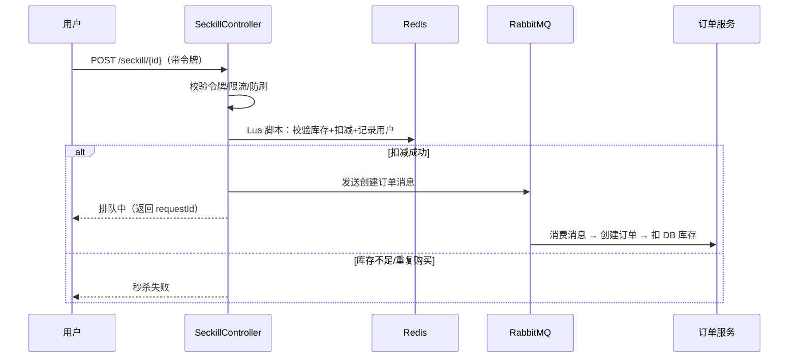

# 秒杀系统设计文档（v1 模板）

> 用途：W0 写 v1（方案），W1-W2 边开发边补充实测数据；面试时按这份讲 10 分钟。
> 建议 2~3 页，重点：**为什么这么设计 + 数据对比 + 踩了什么坑**。

## 1. 背景与目标

- 现状：mall 原生下单 `OmsPortalOrderServiceImpl.lockStock()` 是「查-改-写」（第 734 行附近），
  无锁、无版本号，高并发下存在超卖风险。
- 目标：实现秒杀场景，支撑 1000 QPS 级别（按本机压测能力定），**超卖 = 0**，响应 P99 < 200ms。
- 非目标：不引入微服务拆分，不重构原订单模型。

## 2. 方案对比（自己选一个并写理由）

| 方案 | 优点 | 缺点 | 是否采用 |
|---|---|---|---|
| 数据库乐观锁（stock >= n 条件更新） | 简单、强一致 | 数据库压力大、热点行锁 | 兜底采用 |
| Redis + Lua 预扣库存 | 原子、高并发 | 需解决最终一致 | ✅ 主方案 |
| MQ 异步下单 | 削峰、解耦 | 链路复杂、需幂等 | ✅ 配合使用 |

## 3. 表设计

```sql
-- 秒杀活动
seckill_activity(id, name, start_time, end_time, status, create_time)
-- 秒杀商品（库存预热来源）
seckill_product(id, activity_id, product_id, seckill_price, stock, create_time)
-- 秒杀订单（幂等/防重）
seckill_order(id, user_id, product_id, order_id, status, create_time,
              UNIQUE KEY uk_user_product (user_id, product_id))
```

## 4. 核心流程（时序图，按实际补全）



## 5. 关键实现要点（逐条写清楚）

- [ ] **Lua 脚本**：KEYS/ARGV 设计、返回值约定、原子性说明（贴脚本）
- [ ] **幂等**：令牌怎么发（Redis）、唯一索引兜底、重复请求怎么返回
- [ ] **限流**：Sentinel/Guava 的阈值、被限流后的返回
- [ ] **防刷**：同一用户频率限制、活动时间校验
- [ ] **超时回补**：延迟队列（TTL+死信）或定时任务兜底；回补 Redis + DB 库存
- [ ] **一致性**：Redis 扣减成功但 MQ 失败怎么办（本地消息表/重试/对账）

## 6. 接口定义

| 接口 | 方法 | 参数 | 返回 | 是否需要登录 |
|---|---|---|---|---|
| /seckill/token | GET | activityId | token | 是 |
| /seckill/{id} | POST | token | requestId/结果 | 是 |
| /seckill/result/{requestId} | GET | - | 订单状态 | 是 |

## 7. 压测方案（W2 填实测）

- 工具：wrk / JMeter
- 场景：100/500/1000 并发，持续 60s
- 指标：QPS、平均 RT、P99、错误率、超卖数、CPU/内存
- 对比组：原版 `lockStock` 直连下单 vs 秒杀链路

## 8. 实测数据（W2 填）

| 场景 | QPS | 平均 RT | P99 | 错误率 | 超卖 |
|---|---|---|---|---|---|
| 原版下单 | | | | | |
| 秒杀（Redis+Lua） | | | | | |
| 秒杀（+MQ 异步） | | | | | |

## 9. 风险与兜底

- Redis 宕机：降级到 DB 条件更新 / 直接限流挡掉
- MQ 积压：消费端扩容、失败重试上限 + 死信告警
- 库存不一致：活动结束后对账脚本（Redis vs DB）

## 10. 面试讲述版（自己提炼）

- 3 分钟：我做了什么、解决了什么原版问题、数据是多少
- 追问预案：为什么不用悲观锁/分布式锁？MQ 消息丢了怎么办？重复消费怎么幂等？超卖怎么发现的？
