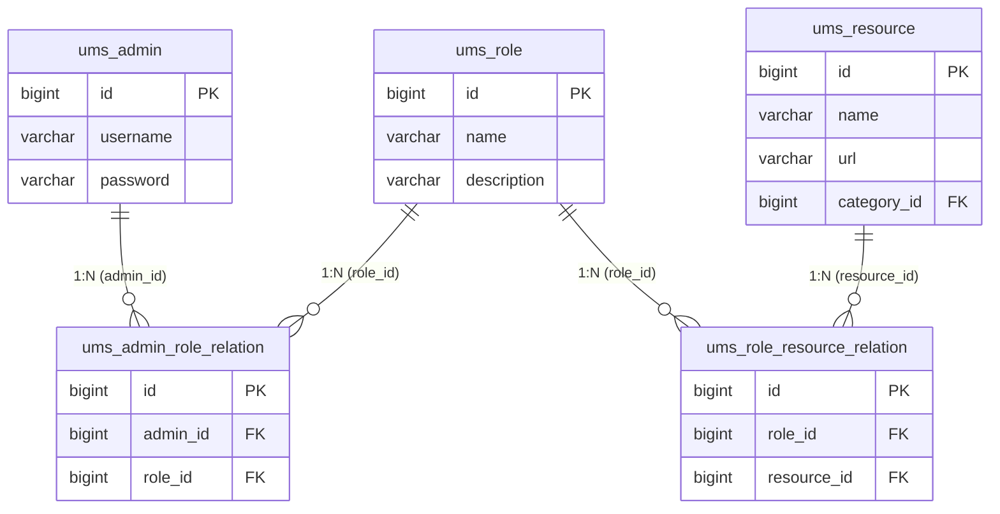
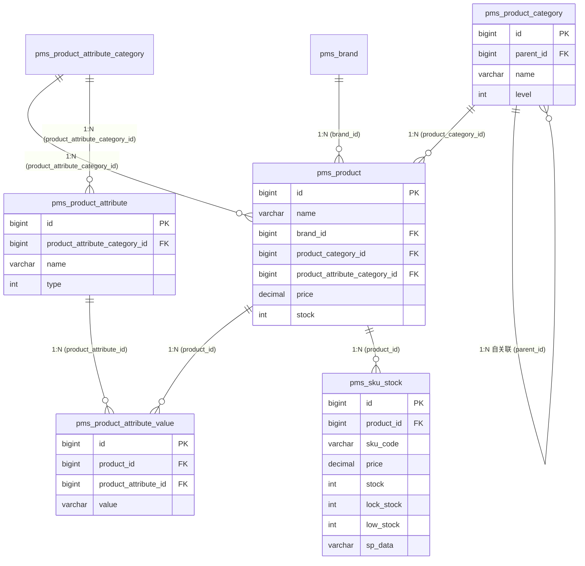
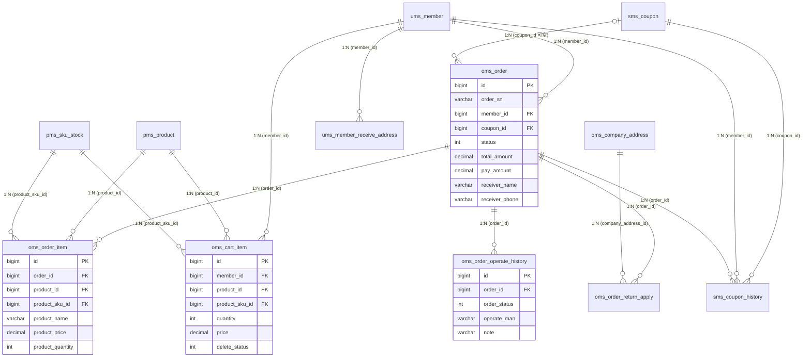

# mall 数据库梳理与 ER（W0 产出）

> 数据库 `mall` 共 **76 张表**，**没有物理外键（FK = 0）**——所有表关系由代码逻辑维护。
> 重点只画 3 条链路：权限（ums）、商品（pms）、订单（oms），不要平均用力。

## 0. 先记住 3 个结论

1. **找关系 = 找 `表名_id` 字段**：子表里的 `xxx_id` 指向 `xxx` 表的主键 `id`，外键永远在「多」的一方。
2. **纯中间表 = 多对多**（如 `ums_admin_role_relation`）；**带业务字段的中间表 = 业务实体**（如 `oms_order_item`，订单与商品的多对多靠它实现）。
3. **判断顺序**：先看外键在哪张表 → 再看外键列有没有唯一约束 → 再看是不是纯中间表/自关联 → 最后用 JOIN 数据验证 + 业务语义兜底。

## 1. 怎么判断 1:N / N:N / 1:1（方法论）

| 观察到的特征 | 关系 | 本项目例子 |
|---|---|---|
| 子表有 `父表_id`，父表无反向列 | **父 1 : 子 N** | `pms_sku_stock.product_id` → `pms_product`（一个商品多个 SKU） |
| 关联表**只有两个外键列**、没有业务字段 | **A N : N B** | `ums_admin_role_relation`（用户↔角色）、`ums_role_resource_relation`（角色↔资源） |
| 关联表**带业务字段**（数量/价格/快照） | 本质是业务实体，同时承担 N:N | `oms_order_item` 让「订单↔商品」变成 N:N，还存了快照 |
| 外键列有 **UNIQUE** 约束 / 外键就是另一表主键 | **1 : 1** | `ums_member_statistics_info.member_id`（一个会员一条统计） |
| 表内有指向**自己**的外键 | **自关联 1 : N** | `pms_product_category.parent_id`（分类树） |

**判断口诀（四步）**：
1. **找外键**：谁的字段里存了别人的 `id`，谁就是「N」端；
2. **看中间表**：纯外键表 → N:N；带业务字段 → 业务实体 + N:N；
3. **看唯一约束**：外键列 UNIQUE → 退化成 1:1；
4. **数据验证**：`LEFT JOIN` 看匹配率（正常关系应接近 100%）+ 业务语义确认。

## 2. 表分组（实测 76 张）

| 前缀 | 业务域 | 表数量 | 核心表 |
|---|---|---|---|
| `ums_` | 用户 / 权限 / 会员 | **25** | ums_admin、ums_role、ums_resource、ums_admin_role_relation、ums_role_resource_relation、ums_member、ums_member_receive_address、ums_menu、ums_permission（旧版） |
| `pms_` | 商品 | **18** | pms_product、pms_sku_stock、pms_product_category、pms_brand、pms_product_attribute*、pms_album、pms_comment |
| `oms_` | 订单 | **8** | oms_order、oms_order_item、oms_cart_item、oms_order_operate_history、oms_order_return_apply、oms_company_address、oms_order_return_reason、oms_order_setting |
| `sms_` | 营销 + 首页内容 | **13** | sms_coupon、sms_coupon_history、sms_flash_promotion*、sms_home_advertise、sms_home_brand、sms_home_new_product、sms_home_recommend_product |
| `cms_` | 内容 | **12** | cms_help、cms_subject、cms_topic、cms_prefrence_area、cms_member_report |
| ~~`home_`~~ | ❌ **不存在**（教程里的 `home_*` 前缀是旧版/其他项目，本项目首页数据都在 `sms_home_*`） | 0 | - |

> 25 + 18 + 8 + 13 + 12 = **76**，没有 `home_` 前缀的表；所以 `home_brand/home_new_product/home_recommend_product` 实际是 `sms_home_brand`、`sms_home_new_product`、`sms_home_recommend_product`。
>
> **权限有两套表**：新版（`ums_resource` + `ums_role_resource_relation`，当前 URL 动态鉴权用这套）+ 旧版（`ums_permission`、`ums_admin_permission_relation`、`ums_role_permission_relation`，历史遗留，仅剩 MBG 生成的 Mapper）；`ums_menu` 系负责后台左侧菜单。

### 数据抽样（我自己跑的，校验用）

```
-- 管理员 → 角色（去 ums_admin 表看 role 关系）
1,test,超级管理员 / 3,admin,超级管理员 / 6,productAdmin,商品管理员 / 7,orderAdmin,订单管理员
-- 角色 → 资源数量
超级管理员 29 个资源；商品管理员 10 个；订单管理员 7 个
-- ums_resource 样例（url 就是动态权限的数据来源）
/brand/**、/productAttribute/category/**、/productAttribute/**、/productCategory/**、
/product/**、/sku/**、/order/**、/returnApply/**、/returnReason/**、/orderSetting/**
```

## 3. 必画的 3 张 ER

> 说明：ER 图标的是**逻辑关系**（因为库里没有物理外键），箭头方向 = 外键在「N」端。

### ER-1 权限模型（ums）——`用户 N:N 角色 N:N 资源`



**关系解读**：`ums_admin` 和 `ums_role` 是 **N:N**（靠 `ums_admin_role_relation` 拆成两个 1:N）；`ums_role` 和 `ums_resource` 也是 **N:N**（靠 `ums_role_resource_relation`）。
注意：**没有 `ums_admin_permission` 这张表**——权限链路是「admin →(admin_role_relation)→ role →(role_resource_relation)→ resource」。
**思考题答案（URL 鉴权怎么映射）**：登录时按 `admin_id` 查角色、再按角色查资源；`ums_resource.url` 存的就是受保护接口路径（如 `/product/**`），把它加载成用户的权限集合，请求进来时用当前用户权限对比资源 URL（动态权限）。

### ER-2 商品模型（pms）——SPU / SKU / 属性



**注意**：
- `pms_product`（SPU）和 `pms_sku_stock`（SKU 库存）**不是"字段包含"关系**，而是两个层级：商品存公共信息（名称/品牌/分类/属性分类），SKU 存具体规格的价格/库存；一个商品对应多个 SKU。
- `pms_sku_stock` 与属性值之间**没有表关联**——SKU 的属性组合存在 `pms_sku_stock.sp_data` 字段（JSON 字符串，如 `[{"key":"颜色","value":"黑色"}]`）。
**思考题答案（stock / lock_stock / low_stock）**：
- `stock` = 实际库存；`lock_stock` = 已下单未支付的**锁定库存**；`low_stock` = 库存预警阈值
- 下单：`lock_stock + 1`；支付：`stock - 1` 且 `lock_stock - 1`；取消：`lock_stock - 1`

### ER-3 订单模型（oms）——订单明细是「业务中间表」



**关键点**：
- 「订单↔商品」是 **N:N**，靠 `oms_order_item` 实现，且明细里**冗余** `product_name / product_price`（历史快照，商品改价改名不影响老订单）
- `oms_order` **没有地址外键**：收货地址是**快照字段**（`receiver_name / receiver_phone / ...`），`ums_member_receive_address` 只属于会员（1:N）
- `oms_order_operate_history`、`oms_order_return_apply` 都是 **1:N**（一个订单多条记录），不是 N:N
- 订单状态 `status`：0 待付款 / 1 待发货 / 2 已发货 / 3 已完成 / 4 已关闭 / 5 无效订单；状态流转同时记在 `oms_order.status` 和 `oms_order_operate_history`

## 4. 自测问题（参考答案）

1. **一个商品下单时涉及哪几张表？**
   `oms_cart_item`（读购物车）→ `pms_sku_stock`（`lock_stock` 锁定）→ `oms_order`（订单主表）→ `oms_order_item`（订单明细快照）→ 发 RabbitMQ 延迟消息；支付成功后：`pms_sku_stock`（`stock` 扣减、`lock_stock` 释放）+ `oms_order`（status 0→1）+ `oms_order_operate_history`；取消订单则释放 `lock_stock`。
2. **权限模型为什么设计成 用户-角色-资源 三层？**
   解耦与可复用：给用户改权限只需换角色；角色权限调整只改角色-资源关系；符合最小授权原则。
3. **`oms_order_item` 里为什么要冗余商品名和价格？**
   订单是历史凭证，必须保留下单时的商品名称/单价/数量快照；否则商品后来改名、调价会让历史订单错乱。

## 5. 关键发现（笔记 / 面试素材）

1. **无物理外键**：FK 数量 = **0**，关系全靠代码维护。
2. **逻辑外键的真实代价（实测）**：`oms_order_item` 有 **5 条孤儿明细**（`product_sku_id=90` 已从 SKU 表删除）；`oms_order.coupon_id` 有 **20 个订单**指向 `sms_coupon` 里不存在的优惠券。
3. **SKU 属性用 JSON**：`pms_sku_stock.sp_data`（字符串），不是属性中间表。
4. **逻辑删除**：`oms_cart_item.delete_status`（0 正常 / 1 删除），查购物车必须带条件。
5. **文档坑**：`home_*` 前缀不存在（实际是 `sms_home_*`）；权限有新旧两套表，别混用。

## 6. 关系速查表（子表.字段 → 父表.主键）

| 子表.字段 | → 父表.主键 | 关系 |
|---|---|---|
| ums_admin_role_relation.admin_id | ums_admin.id | N:1 |
| ums_admin_role_relation.role_id | ums_role.id | N:1 |
| ums_role_resource_relation.role_id | ums_role.id | N:1 |
| ums_role_resource_relation.resource_id | ums_resource.id | N:1 |
| pms_sku_stock.product_id | pms_product.id | N:1 |
| pms_product.product_category_id | pms_product_category.id | N:1 |
| pms_product_category.parent_id | pms_product_category.id | 自关联 N:1 |
| pms_product.brand_id | pms_brand.id | N:1 |
| pms_product.product_attribute_category_id | pms_product_attribute_category.id | N:1 |
| pms_product_attribute.product_attribute_category_id | pms_product_attribute_category.id | N:1 |
| pms_product_attribute_value.product_attribute_id | pms_product_attribute.id | N:1 |
| pms_product_attribute_value.product_id | pms_product.id | N:1 |
| oms_order.member_id | ums_member.id | N:1 |
| oms_order.coupon_id | sms_coupon.id | N:1（可空） |
| oms_order_item.order_id | oms_order.id | N:1 |
| oms_order_item.product_id | pms_product.id | N:1 |
| oms_order_item.product_sku_id | pms_sku_stock.id | N:1 |
| oms_cart_item.member_id | ums_member.id | N:1 |
| oms_cart_item.product_id | pms_product.id | N:1 |
| oms_cart_item.product_sku_id | pms_sku_stock.id | N:1 |
| oms_order_operate_history.order_id | oms_order.id | N:1 |
| oms_order_return_apply.order_id | oms_order.id | N:1 |
| oms_order_return_apply.company_address_id | oms_company_address.id | N:1 |
| ums_member_receive_address.member_id | ums_member.id | N:1 |
| sms_coupon_history.coupon_id | sms_coupon.id | N:1 |
| sms_coupon_history.member_id | ums_member.id | N:1 |
| sms_coupon_history.order_id | oms_order.id | N:1 |

## 7. 验证 SQL（可直接在 DataGrip 跑）

```sql
-- 1) 确认没有物理外键
SELECT COUNT(*) AS fk_count FROM information_schema.KEY_COLUMN_USAGE
WHERE table_schema='mall' AND referenced_table_name IS NOT NULL;

-- 2) 验证逻辑关系（匹配率接近 100% 说明关系成立）
SELECT '订单明细→订单' AS relation, COUNT(*) total, SUM(o.id IS NOT NULL) matched
FROM mall.oms_order_item i LEFT JOIN mall.oms_order o ON o.id=i.order_id
UNION ALL SELECT '订单明细→SKU', COUNT(*), SUM(s.id IS NOT NULL)
FROM mall.oms_order_item i LEFT JOIN mall.pms_sku_stock s ON s.id=i.product_sku_id
UNION ALL SELECT '订单→会员', COUNT(*), SUM(m.id IS NOT NULL)
FROM mall.oms_order o LEFT JOIN mall.ums_member m ON m.id=o.member_id
UNION ALL SELECT '订单→优惠券', COUNT(*), SUM(c.id IS NOT NULL)
FROM mall.oms_order o LEFT JOIN mall.sms_coupon c ON c.id=o.coupon_id WHERE o.coupon_id>0
UNION ALL SELECT 'SKU→商品', COUNT(*), SUM(p.id IS NOT NULL)
FROM mall.pms_sku_stock s LEFT JOIN mall.pms_product p ON p.id=s.product_id
UNION ALL SELECT '购物车→商品', COUNT(*), SUM(p.id IS NOT NULL)
FROM mall.oms_cart_item ci LEFT JOIN mall.pms_product p ON p.id=ci.product_id;

-- 3) 查字段中文注释（写文档很有用）
SELECT table_name, column_name, column_type, column_comment
FROM information_schema.columns
WHERE table_schema='mall'
  AND table_name IN ('oms_order','pms_sku_stock','ums_resource')
  AND column_comment <> '';
```
