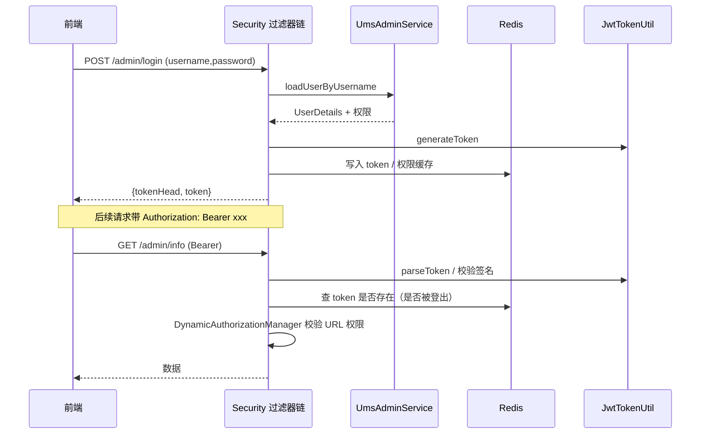
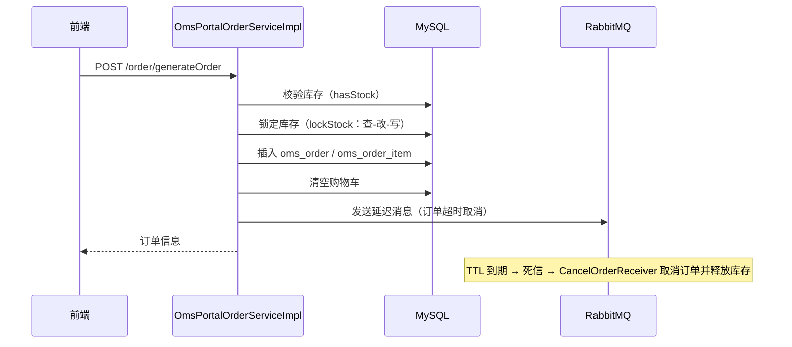
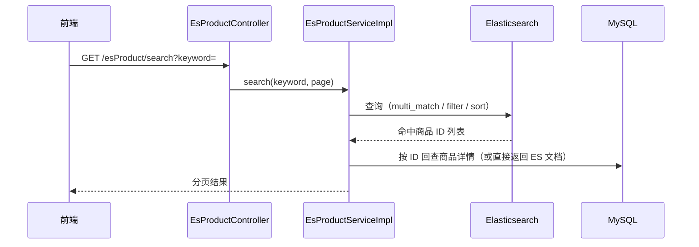

# 核心时序图（W0 产出）

> 用 mermaid 画，把类名/表名补全。面试讲项目时的骨架就是这三张图。

## 时序 1：后台登录 + JWT 鉴权（mall-admin / mall-security）

> 必答：JWT 无状态，怎么实现"登出"和"改密后旧 token 失效"？

## 时序 2：下单主流程（mall-portal / OmsPortalOrderServiceImpl）

> 必答：`lockStock` 的并发问题是什么？延迟队列和定时扫表各自的优缺点？

## 时序 3：商品搜索（mall-search / EsProductServiceImpl）

> 必答：ES 和 MySQL 数据怎么同步？为什么搜索用 ES 不用 MySQL like？

## 完成标准

- [ ] 三张图能不看笔记画出来（手绘/白板）
- [ ] 每个图能讲 2 分钟，包含"为什么这么设计"
- [ ] 每个"必答"都能答出 1 个关键点 + 1 个踩坑点
